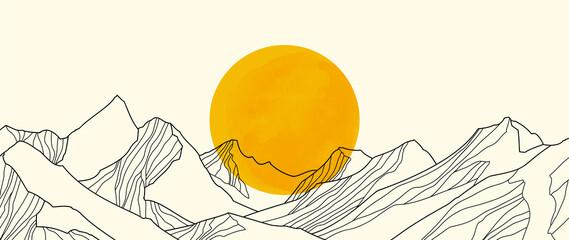
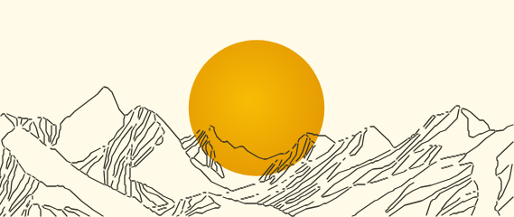
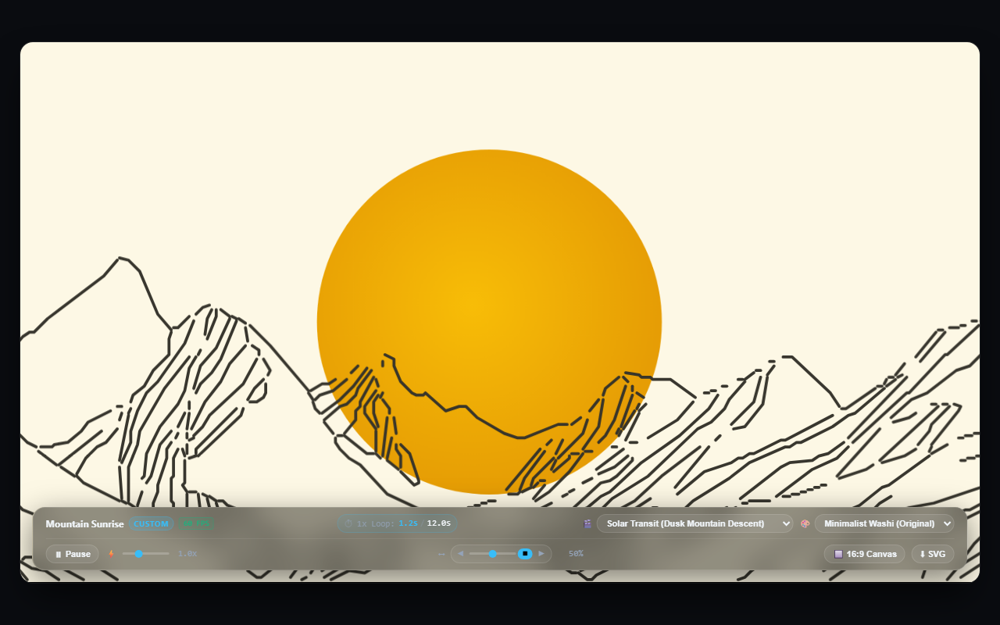
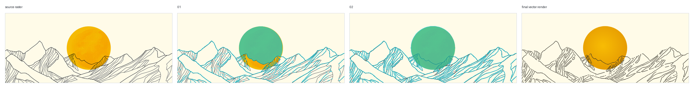
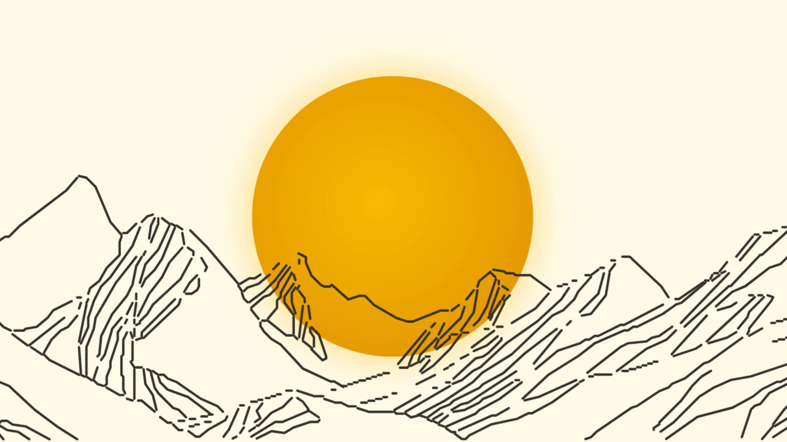
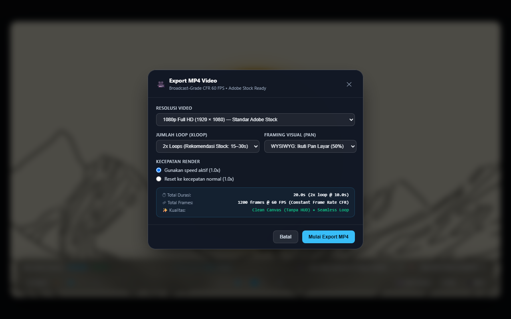
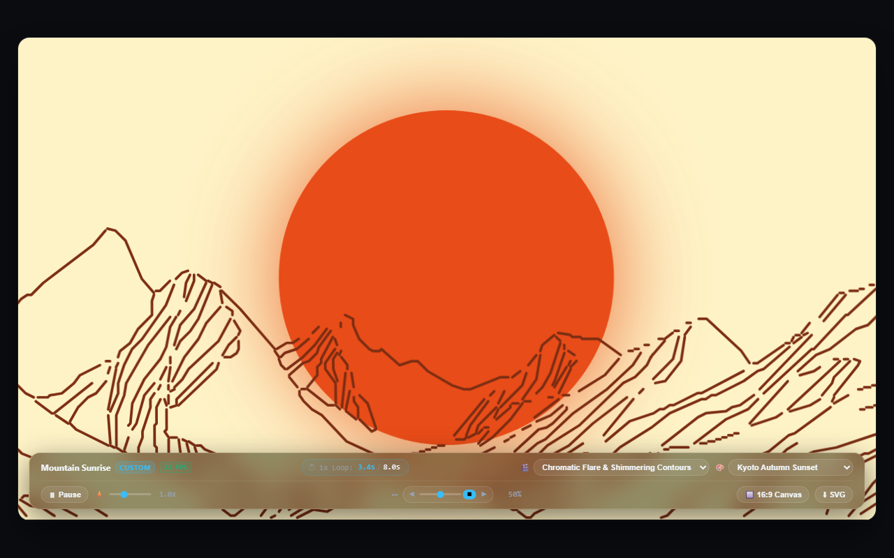
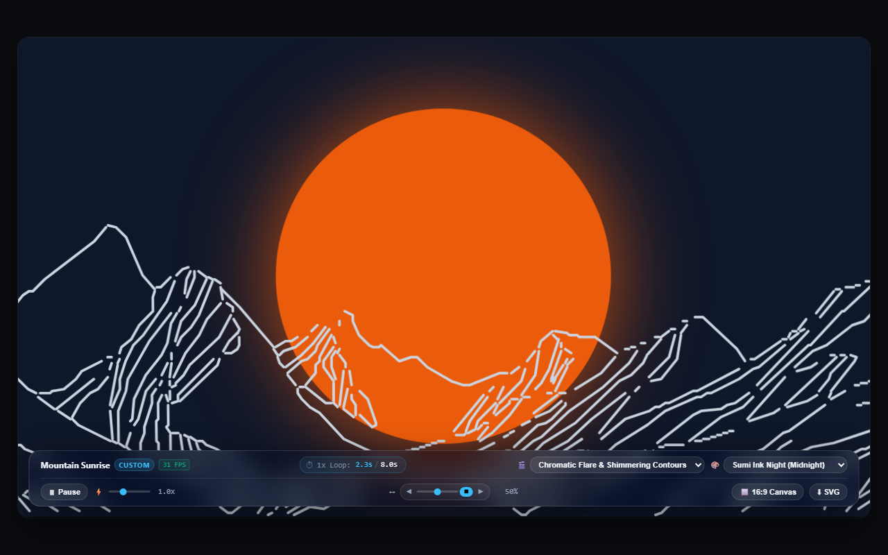
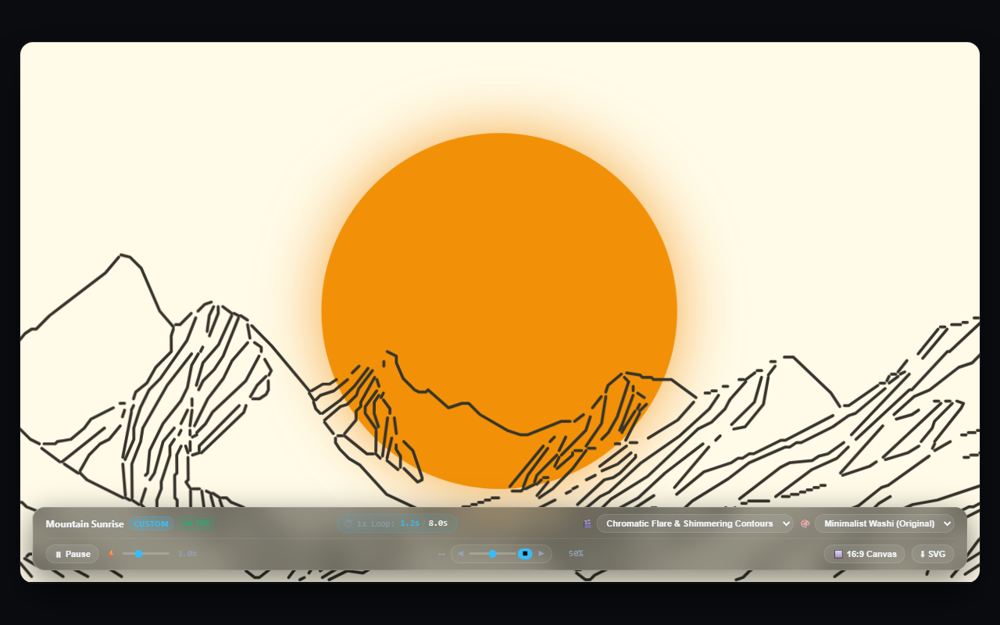

# Pixel2SVG-HTML Studio

> **Precision Raster-to-SVG Vectorizer · Semantic Layer Architecture · Context-Aware CSS Motion Studio · Adobe Stock Broadcast Video Renderer**

[](https://www.python.org/)
[](https://playwright.dev/)
[](https://ffmpeg.org/)
[](#broadcast-video-specifications)
[](LICENSE)

**Pixel2SVG-HTML** is an advanced vectorization and animation toolchain. It converts raster artwork (PNG, JPG, WebP, screenshots) into clean, semantic SVGs, generates standalone interactive motion studios with frosted-glass HUDs, bakes pan framing and playback speed into 4D WYSIWYG standalone SVGs, and renders broadcast-grade 60fps Constant Frame Rate (CFR) MP4 / Apple ProRes videos compliant with Adobe Stock, Getty Images, and Shutterstock requirements.

---

## Visual Showcase & Before / After

### 1. Vector Fitting & Motion Studio Overview

| 1. Original Raster Source | 2. Semantic SVG Vector | 3. Motion Studio (Frosted HUD) |
| :---: | :---: | :---: |
|  |  |  |
| *Low-res raster landscape (569x240)* | *Clean, smooth vector with semantic layers* | *Interactive motion studio with live HUD dock* |

### 2. Fitting Progression (Overlay QA Strip)

Rather than blind pixel tracing, Pixel2SVG-HTML uses a lowest-complexity geometric fitting approach. Smoothness and Bezier curvature are hard quality gates:



```
[Source Raster] ──> [Coarse Geometric Fit] ──> [Refinement & Bezier Smoothing] ──> [Clean Semantic SVG]
```

### 3. Broadcast Video Output Frame (1080p Full HD)

Pure canvas capture with zero browser chrome, zero rounded container corners, and full BT.709 color primaries:



---

## Core Features

### 1. Semantic Layer Vectorization
- **Intelligent Structure**: Vector paths are automatically grouped into clean, semantic DOM IDs (`#sun_disk`, `#sky_backdrop`, `#ridge_rear`, `#ridge_mid`, `#ridge_fore`, `#stars`, `#body`, `#wheel_front`, etc.).
- **Smooth Bezier Fitting**: Audits curvature extrema and inflection points (`scripts/svg_path_audit.py`) to prevent noisy, jagged staircase artifacts.
- **Overlay QA Verification**: Measures Intersection over Union (IoU) and generates visual overlay comparison strips (`scripts/render_overlay.py`).

### 2. Context-Aware Motion Engine (`scripts/animate_svg.py`)
- **Automatic Subject Classification**:
  - `motion_background`: Ambient landscape parallax, solar transits, dawn-to-dusk celestial movement, and atmospheric shimmer.
  - `hopping_creature`: Organic squash-and-stretch hopping cycles with anticipation and dynamic drop shadows.
  - `moving_vehicle`: Wheel rotation, chassis suspension bobbing, ground motion, and speed lines.
  - `botanical_sway`: Hierarchical wind-driven stem and leaf oscillation.
- **3 Alternative Motion Concepts**: Every subject gets three curated motion styles with organic easing curves (e.g., *Solar Transit & Dawn Bloom*, *Zen Ridge Parallax*, *Chromatic Flare & Shimmer*).
- **Dynamic 4-Preset Color Palettes**: Switch instantaneously between themes (e.g., *Sunset Gold*, *Kyoto Autumn*, *Midnight Sumi-e*, *Chromatic Cyberpunk*) with CSS variable injection.

### 3. Ultra-Slim 2-Row Frosted Glass HUD Dock
- **Row 1 (Top Bar)**: Brand title, active motion concept switcher pills, dynamic color palette selectors, and real-time 1x loop timer telemetry.
- **Row 2 (Bottom Bar)**: Speed multiplier controls (`0.5x`, `1.0x`, `1.5x`, `2.0x`), 16:9 pan framing navigator (`[◀ Left]`, `[Center]`, `[Right ▶]`), and instant Export buttons.
- **Anti-Jitter 1x Loop Timer**: Accurately counts elapsed time per loop (`00:00 / 08.00s`) dynamically scaled with active playback speed.
- **16:9 Shortest-Side Zoom-to-Fill**: Ensures standard video aspect ratios without letterboxing, enabling fluid horizontal camera panning.

| In-HUD Motion Studio | In-HUD MP4 Export Modal |
| :---: | :---: |
|  |  |

### 4. 4D WYSIWYG Standalone SVG Export
- **What You See Is What You Export**: When you adjust the pan position or playback speed in the HUD and click **Export SVG**, the exported file bakes those exact settings directly into the `.svg`!
- **Baked Pan ViewBox**: Calculates the exact 16:9 sub-region `viewBox` using `preserveAspectRatio="xMidYMid meet"` (eliminating squishing or distortion).
- **Baked Speed Multiplier**: Dynamically recalibrates all embedded CSS `@keyframes` animation durations (`duration * (1 / currentSpeed)`).
- **100% Standalone**: Runs purely on embedded CSS without requiring any JavaScript. Can be imported directly into Figma, Adobe Illustrator, After Effects, or web browsers.

### 5. Broadcast Video Export Engine (`scripts/export_video.py`)
- **Direct SVG & HTML Rendering**: Accepts either standalone `.svg` or motion studio `.html` files.
- **Pure Canvas Guarantee**: Captures solely the SVG canvas content without browser viewport borders, outer scrollbars, or rounded container corners.
- **Hardware GPU Warmup Pass**: Pre-renders animation frames offscreen to warm up Chromium shaders and FFmpeg pipes, completely eliminating initial-frame stutter, banding, and tearing.
- **Multi-File & Directory Batch Processing**: Render dozens of SVGs in a single command.

### 6. 1-Click Drag-and-Drop Batch Runner (`render_svg_to_video.bat`)
- Simply drag and drop one or multiple `.svg` files (or entire folders) onto `render_svg_to_video.bat` in Windows Explorer!
- Interactive terminal prompts for:
  - Resolution: `1` = 1080p Full HD (1920x1080), `2` = 4K UHD (3840x2160), `3` = 720p HD (1280x720)
  - Loop Count: `1` = 1x, `2` = 2x, `3` = 3x, `5` = 5x loops
- Automatically outputs videos with descriptive metadata naming: `<name>_<concept>_<palette>_<ratio>_<speed>_<loops>_<res>.mp4`.

---

## Dynamic Palette Showcase

Each motion studio comes with 4 handcrafted color schemes with coordinated lighting, gradients, and ink densities:

| Sunset Gold | Kyoto Autumn |
| :---: | :---: |
|  |  |
| **Midnight Sumi-e** | **Chromatic Cyberpunk** |
|  |  |

---

## Broadcast Video Specifications

Videos generated by `scripts/export_video.py` meet the strict technical standards of major commercial stock platforms:

| Metric | Stock Platform Standard (Adobe Stock / Getty) | Pixel2SVG-HTML Engine |
| :--- | :--- | :--- |
| **Frame Rate** | Strict Constant Frame Rate (CFR), No VFR | **60.000 FPS CFR** via Playwright tick synchronizer |
| **Color Space** | Rec.709 / BT.709 Standard Gamut | **BT.709** (`bt709` primaries, transfer & matrix) |
| **Chroma Subsampling** | YUV 4:2:0 planar | **yuv420p** |
| **H.264 Profile** | High Profile, Level 4.2+ | **High Profile 4.2**, CRF 16 (Visually Lossless) |
| **Container Flags** | Fast-start streaming metadata | `+faststart` (moov atom at file header) |
| **ProRes Support** | Apple ProRes 422 HQ (Broadcast Master) | Supported via `--codec prores` (`.mov`) |
| **Loop Integrity** | Zero first-frame glitch, seamless wrap | **Hardware GPU Warmup Pass** enabled |

---

## Installation & Setup

### 1. Prerequisites
- **Python**: Version 3.10 or higher
- **FFmpeg**: Version 6.0 or higher (available in system `PATH`)
- **OS**: Windows, macOS, or Linux

### 2. Install Python Dependencies
```bash
git clone https://github.com/mfahryf/pixel2svg-html.git
cd pixel2svg-html

# Create and activate virtual environment (optional but recommended)
python -m venv .venv
# Windows:
.venv\Scripts\activate
# Linux/macOS:
# source .venv/bin/activate

# Install requirements
pip install -r requirements.txt

# Install Playwright headless browser
playwright install chromium
```

---

## Workflow & Usage Guide

### Step 1: Trace & Measure Raster Artwork
Measure your raster image and fit clean vector primitives:
```bash
python scripts/render_overlay.py logo.svg source.png \
  --out outputs/fit_iterations/01_overlay.png \
  --render-out outputs/final_render.png \
  --report outputs/fit_metrics.json
```

Audit curve smoothness and Bezier inflections:
```bash
python scripts/svg_path_audit.py logo.svg \
  --out-svg outputs/bezier_segments.svg \
  --report outputs/bezier_audit.json
```

### Step 2: Generate Standalone DOM-Rebuilt HTML
Convert the static SVG into a zero-dependency HTML file that rebuilds the vector using JavaScript DOM calls:
```bash
python scripts/svg_to_js_html.py outputs/mountain_sunrise/mountain_sunrise.svg
```

### Step 3: Generate Context-Aware Motion Studio
Generate the interactive motion studio HTML and standalone animated SVG:
```bash
python scripts/animate_svg.py outputs/mountain_sunrise/mountain_sunrise.svg --category motion_background
```
Outputs:
- `<subject>_motion.html`: Full interactive motion studio with 2-row frosted HUD dock, camera framing, speed controls, and export modals.
- `<subject>_motion.svg`: Pure standalone animated SVG with embedded CSS keyframes.

### Step 4: Export Broadcast-Quality Video

#### Method A: Windows Drag-and-Drop Batch Runner
1. Select one or more `.svg` files (or a folder).
2. Drag and drop them directly onto `render_svg_to_video.bat`.
3. Follow the interactive prompts to choose resolution and loop count.

#### Method B: Direct Command Line (Single or Batch)
Render a single animated SVG to 1080p 60fps MP4:
```bash
python scripts/export_video.py outputs/mountain_sunrise/mountain_sunrise_motion.svg --res 1080p --loops 2
```

Render in 4K UHD:
```bash
python scripts/export_video.py outputs/mountain_sunrise/mountain_sunrise_motion.svg --res 4k --loops 1
```

Render Apple ProRes 422 HQ Broadcast Master (`.mov`):
```bash
python scripts/export_video.py outputs/mountain_sunrise/mountain_sunrise_motion.svg --codec prores --res 1080p
```

Batch render all SVG files in a directory:
```bash
python scripts/export_video.py outputs/mountain_sunrise/ --res 1080p --loops 2
```

---

## Repository Structure

```
pixel2svg-html/
├── .github/                      # CI/CD and repository workflows
├── docs/
│   ├── showcase/                 # High-resolution screenshots and comparison strips
│   └── process/                  # Overlay fitting QA evidence
├── outputs/
│   ├── mountain_sunrise/         # Sample mountain sunrise deliverables (SVG, HTML, metrics)
│   └── desert_landscape/         # Sample desert landscape deliverables (SVG, HTML, metrics)
├── references/                   # Kinematics and motion design reference guides
│   ├── contextual-motion-kinematics.md
│   ├── fitting-playbook.md
│   └── motion-backgrounds.md
├── scripts/
│   ├── animate_svg.py            # Context-aware motion studio & 4D WYSIWYG SVG generator
│   ├── export_video.py           # Headless Playwright + FFmpeg 60fps CFR broadcast exporter
│   ├── render_overlay.py         # Raster overlay comparison and IoU metric calculation
│   ├── svg_path_audit.py         # Curvature and Bezier segment quality auditor
│   ├── svg_to_js_html.py         # Dependency-free DOM-rebuilt HTML generator
│   └── overlay_progress_strip.py # Multi-stage QA strip generator
├── render_svg_to_video.bat       # Windows drag-and-drop batch rendering runner
├── requirements.txt              # Python package dependencies
├── SKILL.md                      # Codex / Antigravity agentic skill specification
└── LICENSE                       # MIT License
```

---

## License

This project is licensed under the [MIT License](LICENSE).
